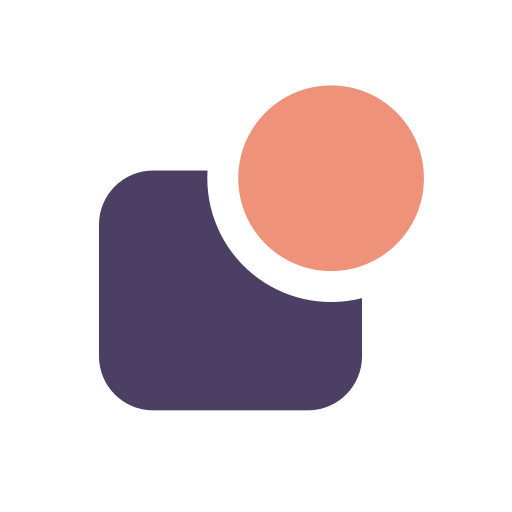

<div align="center">


# MeguvizDrawable

**Reusable drawing recipes for Android Drawable and Jetpack Compose**

[Maven Central](https://central.sonatype.com/artifact/io.github.jichuo1.meguviz/meguviz-drawable-android) · [AI Integration & Migration Skill](.agents/skills/meguviz-drawable/SKILL.md) · [Quick start](#create-a-view-background) · [License](LICENSE)

</div>

Define a shape, fill, gradient or stroke as an immutable Java recipe. Use the same recipe for an Android `Drawable` or a Compose painter. Recipes can be shared and each View gets its own drawable.

## Install

Enable `google()` and `mavenCentral()` in your Gradle repositories. The Android artifact requires `compileSdk` 37 or newer and supports devices from API 21. It includes the recipe model as a dependency. All five core and bridge artifacts below are published at `1.2.0` on Maven Central and aligned by `io.github.jichuo1.meguviz:meguviz-bom:1.2.0`.

```kotlin
dependencies {
    implementation(platform("io.github.jichuo1.meguviz:meguviz-bom:1.2.0"))
    implementation("io.github.jichuo1.meguviz:meguviz-drawable-android")
    // Or declare the version directly: implementation("io.github.jichuo1.meguviz:meguviz-drawable-android:1.2.0")
}
```

## Create a View background

```java
import io.github.jichuo1.meguviz.drawable.android.RecipeDrawable;
import io.github.jichuo1.meguviz.drawable.model.DrawingRecipe;
import io.github.jichuo1.meguviz.drawable.model.FillSpec;
import io.github.jichuo1.meguviz.drawable.model.Length;
import io.github.jichuo1.meguviz.drawable.model.ShapeSpec;
import io.github.jichuo1.meguviz.drawable.model.StrokeSpec;

DrawingRecipe card = DrawingRecipe.of(
        ShapeSpec.roundRect(Length.dp(16)), FillSpec.solid(0xFFFFFFFF))
        .withStroke(new StrokeSpec(Length.dp(1), 0x1F000000));
view.setBackground(RecipeDrawable.forView(view, card));
```

`forView` uses the View's resource density at creation. Create a new drawable when that density changes. The Canvas renderer supports basic shapes, stateful fills, linear gradients and centered strokes. Set optical insets to zero for this renderer.

## Choose a module

The following Central artifacts use the groupId `io.github.jichuo1.meguviz` (`1.2.0`).

| Artifact | Minimum SDK | Use |
| --- | --- | --- |
| `meguviz-drawable-core` | JVM 8+ | Java recipes, state matcher cache, `FlightCache` and `BindingScope` |
| `meguviz-drawable-android` | API 21 | Android `Drawable`, `ViewSlots` and Canvas rendering |
| `meguviz-drawable-compose` | API 23 | [Compose painter adapter](compose) |
| `meguviz-drawable-meguviz-android` | API 27 | [Integration with MeguvizAndroid lifecycle and resources](meguviz-android) |
| `meguviz-drawable-meguviz-ui` | API 27 | [Background binding for MeguvizUI](meguviz-ui) |

An optional [Lumen bridge module](lumen) (`meguviz-drawable-lumen`, API 27) is available for source/local builds (`-Pmeguviz.profile=bridges`) and is not published on Maven Central.

## Docs & Examples

- [AI Integration & Migration Skill](.agents/skills/meguviz-drawable/SKILL.md) — engineering assessment, module selection, API reference and migration guide.
- [Quickstart](docs/engineering/QUICKSTART.md) · [Bridges](docs/engineering/BRIDGES.md) · [FlightCache](docs/engineering/FLIGHT_CACHE.md) · [Android example](android/src/androidTest/java/io/github/jichuo1/meguviz/drawable/android/samples/AndroidQuickStartSample.java) · [Recipe examples](core/src/test/java/io/github/jichuo1/meguviz/drawable/samples/QuickStartSample.java)
- Released under the [Apache License 2.0](LICENSE).
